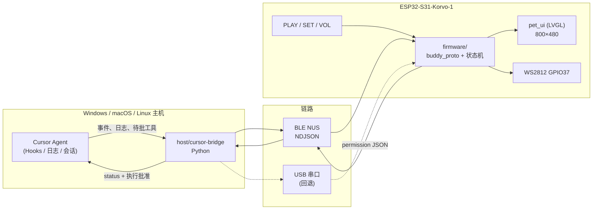

# Korvo 爪爪 架构

桌面 Cursor Agent 状态 → Korvo 开发板 UI/按键的端到端数据流（MVP 为骨架 + 桩代码）。

## 总览

## 组件职责

| 层 | 职责 |
|---|---|
| **Cursor** | 运行 Agent、产生工具批准请求与运行日志；无官方 Korvo 插件 |
| **cursor-bridge** | 聚合会话 → `heartbeat`；收 `permission` → 调用（或桩）批准路径；维护 `tokens_today` 午夜重置 |
| **BLE / 串口** | 单行 JSON；心跳 1–2 Hz；等待批准时加快 |
| **buddy_proto** | 解析 NDJSON，更新 `buddy_snapshot_t` |
| **状态机** | SLEEP / IDLE / RUNNING / WAITING / ERROR |
| **pet_ui** | 左宠物、右状态/token/日志；WAITING 全屏 overlay |
| **输入** | PLAY=approve，SET=deny |

## 安全与范围

- 密钥与 API 调用留在 PC；固件只见脱敏后的 `hint` 与日志片段。
- MVP 不实现设备端 Claude API。
- 社区项目，非 Cursor / Anthropic 认证配件。

## 后续扩展

- ES8389 等待提示音（`audio_chime` 桩）
- 触摸屏批准按钮
- `Claude-` 广播名 + Claude Desktop 桥接复用同一 `REFERENCE.md`
