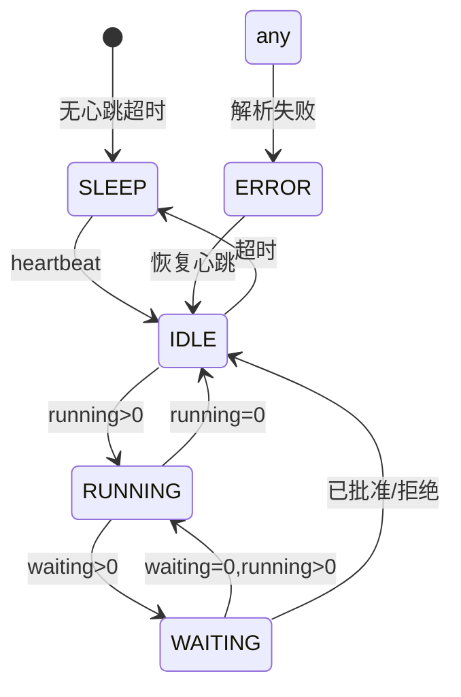

# UI 线框（800×480 RGB565）

子板：**ESP32-S3-LCD-EV-Board-SUB3**，触摸 GT1151。LVGL 逻辑分辨率 800×480（与 `pet_ui` 桩一致）。

## 布局（ASCII）

```
┌──────────────────────────────────────────────────────────────────────────────┐
│  Korvo 爪爪          ● 已连接          11:21                    [WiFi/BLE]   │  y=0..40
├──────────────────────────────┬───────────────────────────────────────────────┤
│                              │  Agent 状态                                    │
│                              │  ┌─────────────────────────────────────────┐  │
│         宠物面部区            │  │ RUNNING  ·  1 任务                       │  │
│         (动画精灵)            │  └─────────────────────────────────────────┘  │
│         320 × 400            │  Token 今日:  42,000 约    累计: 128,450       │
│                              │  ───────────────────────────────────────────  │
│    zzz / 眨眼 / 跑步 /       │  最近日志                                      │
│    举手等待                  │  11:02:01  Running grep in firmware/          │
│                              │  11:02:05  Tool: Shell — npm test             │
│                              │  ...                                           │
│                              │                               320 × 400        │
├──────────────────────────────┴───────────────────────────────────────────────┤
│  PLAY=批准   SET=拒绝   VOL±=亮度                         WS2812 状态色       │  y=440..480
└──────────────────────────────────────────────────────────────────────────────┘

WAITING 时全屏 overlay（半透明底）:
┌──────────────────────────────────────────────────────────────────────────────┐
│                         需要你的批准                                          │
│                    工具: run_terminal_cmd                                     │
│                    npm test -- --run                                          │
│                                                                               │
│              [ PLAY 批准 ]          [ SET 拒绝 ]                              │
│                         (宠物：举手/问号动画)                                  │
└──────────────────────────────────────────────────────────────────────────────┘
```

## 区域坐标（逻辑像素）

| 区域 | x | y | w | h |
|---|---|---|---|---|
| 顶栏 | 0 | 0 | 800 | 40 |
| 宠物 | 0 | 40 | 320 | 400 |
| 右侧面板 | 320 | 40 | 480 | 400 |
| 底栏提示 | 0 | 440 | 800 | 40 |
| 等待 overlay | 0 | 0 | 800 | 480 |

## 状态 → 动画 / LED

| 状态机 | 宠物动画 | 顶栏文案 | WS2812（GPIO37） |
|---|---|---|---|
| SLEEP | 闭眼 zzz | 未连接 / 休眠 | 暗蓝慢呼吸 |
| IDLE | 眨眼 idle | 待命 | 青色常亮 |
| RUNNING | 跑步/忙碌 | 执行中 | 绿色脉冲 |
| WAITING | 举手 + overlay | 等待批准 | 琥珀快闪 |
| ERROR | 困惑 | 链路错误 | 红色 |



## 字体与截断

- 日志区最多显示 6–8 行；`line` 超长尾部 `…`
- `prompt.hint` 最多 2 行
- `tokens_estimated == true` 时在今日 token 旁显示「约」
